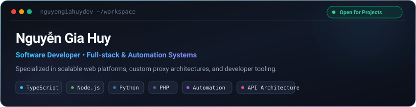

  

 

### ⚡ About Me

Software Developer based in Vietnam with a focus on building scalable web applications, API services, and automated workflow tooling. Passionate about clean code, modular architecture, and high-performance system design.

- 🔭 **Focus Areas:** Full-Stack Web Development, Custom Proxy Services, and Automation Pipelines.
- 🛠 **Core Stack:** TypeScript, Node.js, Python, PHP, React, and MySQL.
- 💡 **Philosophy:** Building reliable software through simple abstractions, robust typing, and practical architecture.
- 🌱 **Continuous Learning:** Exploring distributed systems, concurrency models, and low-latency network protocols.

---

### 🛠️ Technical Toolkit

<table>
  <thead>
    <tr>
      <th align="left" width="28%">Category</th>
      <th align="left" width="72%">Technologies (Vector SVGs)</th>
    </tr>
  </thead>
  <tbody>
    <tr>
      <td><b>Languages</b></td>
      <td>
        
        
        
        
        
      </td>
    </tr>
    <tr>
      <td><b>Frontend &amp; UI</b></td>
      <td>
        
        
        
        
      </td>
    </tr>
    <tr>
      <td><b>Backend &amp; Runtime</b></td>
      <td>
        
        
      </td>
    </tr>
    <tr>
      <td><b>Databases &amp; DevOps</b></td>
      <td>
        
        
        
        
        
      </td>
    </tr>
    <tr>
      <td><b>Tools &amp; Environment</b></td>
      <td>
        
        
        
        
      </td>
    </tr>
  </tbody>
</table>

---

### 🚀 Featured Repositories

| Repository | Description | Primary Stack | Status |
| :--- | :--- | :--- | :---: |
| [**`web-proxy`**](https://github.com/nguyengiahuydev/web-proxy) | High-performance proxy gateway handling dynamic request forwarding and routing | `TypeScript` `Node.js` | 🟢 Active |
| [**`update`**](https://github.com/nguyengiahuydev/update) | Automation scripts and task synchronization utilities | `Python` | 🟢 Maintained |
| [**`tienganh`**](https://github.com/nguyengiahuydev/tienganh) | Web-based interactive vocabulary and language practice portal | `HTML5` `CSS3` `JavaScript` | 🟢 Active |

---

### 📊 Engineering Activity

  
   
  

---

### 📬 Connect

  
  &nbsp;&nbsp;
  
  &nbsp;&nbsp;
  

